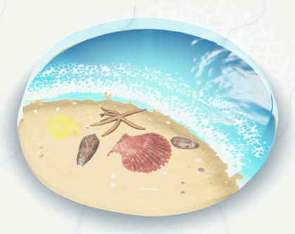
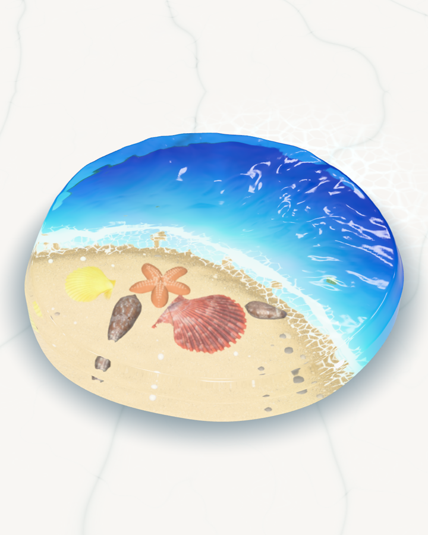

# resin-art

A Claude skill and a small TypeScript library for epoxy-resin art rendered with
three.js. Ask for a piece in plain words, or hand over a photo of one, and you get a
real-time 3D piece of cured resin: water you can see through, sand and shells set
inside, glints that travel across a wave top as it turns.

<p align="center"></p>

One piece definition then becomes whatever you need: a web page or embeddable
component, a PNG, a cutout PNG with no background, a sprite sheet, a turntable
video (with or without alpha), or a 3D file (GLB, USDZ, STL, OBJ).

| Seashore | Ocean slab | Rose cube | Flower coaster |
|---|---|---|---|
|  |  |  |  |

## Use the skill

Clone it straight into your Claude Code skills folder and install the dependencies
(three.js, Vite and TypeScript; the export script also uses ffmpeg and a local
Chrome):

```sh
git clone https://github.com/lcalmsky/resin-art ~/.claude/skills/resin-art
cd ~/.claude/skills/resin-art && npm install
```

If you keep the repo somewhere else, link it instead:
`ln -s /path/to/resin-art ~/.claude/skills/resin-art`. Claude Code opened inside the
repo also picks the skill up from `.claude/skills/resin-art/`.

Then just ask. A sentence is enough, a reference photo is enough, and both together
work best:

- "바다 한조각 같은 레진 키링 만들어줘. 모래에 조개 하나 박혀 있게."
- "Cast a dandelion head in a clear cube and give me a 10-second video for reels."
- "Here's a photo of my coaster. Make it as a cutout PNG for our product page."
- "Same tray, but as a GLB I can drop into Unity."

The skill reads what the result is for and picks the format itself: a product page
gets a PNG, "누끼" or "for Figma" gets a cutout, "for Unity" gets a GLB, "릴스" gets a
1080x1920 MP4. It asks only when nothing in the request points to a format (for
example "make it an asset", which could be 2D or 3D), and then only once.

It builds one piece first, shows you a still, and waits for a yes before making a
set or exporting.

## What you can get

| Use | Format | Notes |
|---|---|---|
| Website, landing page, React | web page, `mountPiece()` component, static build | drag to turn, slow idle spin |
| Product photo, thumbnail | PNG | any size; marble, wood, linen or plain table |
| Figma, slides, stickers, 2D games | cutout PNG, sprite sheet | clear resin keeps its partial transparency |
| Reels, shorts, posts | MP4, GIF | one seamless full turn |
| Video editing, web overlays | MOV (ProRes 4444), WebM (VP9), APNG | with alpha |
| Blender, Unity, three.js | GLB | transmission, IOR and pigment kept; real size |
| iPhone AR | USDZ | resin becomes tinted see-through (USD has no refraction) |
| 3D printing, mould masters | STL | resin body only, in millimetres |

<p align="center"></p>

The cutouts above sit on a dark colour they were never rendered against. A cutout is
rendered once over black and once over white; how much the two differ is how much
background shows through, so resin stays glassy instead of turning into a white
sticker.

## Run it yourself

Requires Node 22.18 or newer (TypeScript runs natively), ffmpeg for video, and a local
Chrome or Chromium for exports.

```sh
npm install
npm run dev        # http://localhost:5173, one page per example
npm run typecheck
npm run build
```

Every example page has an export bar under the card (table surface, PNG, cutout,
GLB, USDZ, STL, OBJ) and takes URL flags: `?surface=marble|wood|linen|plain|none`,
`?bg=%23eef0f2`, `?spin=0.3`, `?yaw=30`, `?still`, `?capture` (hides the hint and
bar), `?debug` (step time by hand with `__step(seconds)`), `?t=2.5` (freeze time).

## Export from the command line

```sh
npm run export -- seashore --formats mp4 --size 1080x1350 --seconds 10
npm run export -- rose-cube --formats cutout,sprite --angles 12 --size 1200x1200
npm run export -- flower-coaster --formats mov,webm --surface none
npm run export -- ocean-slab --formats glb,usdz,stl
npm run export -- seashore --formats all
```

Files land in `exports/<piece>/`. Formats: `page` `png` `cutout` `sprite` `mp4`
`gif` `webm` `mov` `apng` `glb` `usdz` `stl` `obj` `web`. Options: `--size WxH`,
`--seconds`, `--fps`, `--angles`, `--surface`, `--bg '#hex'`, `--yaw`, `--tilt`,
`--out`. The script starts its own dev server and a headless Chrome with GPU WebGL,
steps time exactly, and encodes with ffmpeg. 3D files are real size: 1 unit = 3 cm.

## Embed a piece

```ts
import { mountPiece } from './lib/piece.ts';
import { seashore } from './examples/seashore/seashore.ts';

const c = mountPiece(document.querySelector('#hero')!, seashore, { surface: 'none', backdrop: '#ffffff' });
c.pose(30);
const png = await c.snapshot({ width: 1080, height: 1080, matte: true }); // cutout
c.dispose();
```

In React, mount in `useEffect` and return `c.dispose`. The host element needs a size.
With `surface: 'none'`, set `backdrop` to the colour of the page behind it: the canvas
itself stays opaque because the resin refracts what is behind it.

## Write a new piece

A piece is a `PieceDef`: a name, camera framing, and a `build()` that adds meshes to
the turntable.

```ts
import * as THREE from 'three';
import type { PieceDef } from './lib/piece.ts';
import { resin, block } from './lib/resin.ts';
import { rose } from './lib/inclusions.ts';
import { contactShadow } from './lib/light.ts';

export const roseInACube: PieceDef = {
  name: 'rose-in-a-cube',
  studio: { elevation: 20, yaw: 32 },
  build(s) {
    s.turntable.add(new THREE.Mesh(block(1.7, 1.7, 1.7), resin({ tint: '#ffd9d4', depth: 14, thickness: 0.85 })));
    const r = rose({ color: '#ee6f6c' });
    r.scale.setScalar(1.6); r.position.y = 0.7;
    s.turntable.add(r, contactShadow(1.7, 1.7, { color: '#c98d88' }));
  },
};
```

What the library gives you:

| module | |
|---|---|
| `lib/resin.ts` | `resin()` material (transmissive, IOR 1.54); forms `block`, `pour`, `freeformOutline`, `slab`, `disc`, `rippleField`; `pigment()` for tint that deepens and swirls; `scatter()` |
| `lib/inclusions.ts` | `sandMaterial`, `foamTexture` (lace), `flat`, `shell`, `beads` (pearls, bubbles), `glitter`, `pressed` flowers (daisy, five, hydrangea, lace, sprig, leaf), `rose` |
| `lib/light.ts` | tinted `contactShadow` and animated `caustics` on the table |
| `lib/studio.ts`, `lib/surfaces.ts` | softbox light, tables, drag turntable with momentum, light sweep, `?debug` stepping |
| `lib/piece.ts`, `lib/export.ts` | `mountPiece()` and its controller; PNG, cutout and 3D export |
| `lib/noise.ts` | seeded `rng`, `noise2`, `fbm`, `cells` |

Three rules do most of the work, and `SKILL.md` has the rest:

- **Transmission, not opacity.** Resin is a `MeshPhysicalMaterial` with `transmission: 1`; low opacity looks like game glass.
- **Inclusions are opaque.** three.js only refracts opaque objects through transmissive ones, so flowers and foam are alpha-tested sheets and shells are solid meshes.
- **A patterned table.** Clear resin is only visible through what it bends; on a plain table it looks milky.

## Repo layout

| | |
|---|---|
| `SKILL.md`, `references/` | the skill: workflow, rules, and guides for style, pieces, inclusions, outputs, verification and video |
| `lib/` | the library above, eight TypeScript files, only dependency `three` |
| `examples/` | `seashore`, `ocean-slab`, `rose-cube`, `flower-coaster` |
| `scripts/` | `export.ts` (every deliverable), `capture.ts` (page screenshots), `cdp.ts` (headless Chrome driver) |
| `media/` | the images in this README |

## License

MIT
